<div align="center">

<!-- Animated Header Banner -->


<!-- Typing Animation -->


<br/>

</div>

## 🧑‍💻 About Me

```java
public class Deepanshu extends Developer {
    String []stack = "Spring Boot", "MERN (MongoDB, Express.js, React.js, Node.js)";
    String []languages = {"Java", "Python", "C"};
    String []interests = {
        "Data Structures and Algorithms"
        "Full Stack Development",
        "Distributed Systems"
    };
    String goal = "Become a Software Engineer";
    boolean openToWork = true;

    @Override
    public String introduce() {
        return "Building scalable backend systems and solving real-world problems.";
    }
}
```

- 🎓 Final Year **B.Tech Computer Science & Engineering** Student
- 💻 Passionate about **Backend Development, Distributed Systems and Scalable Software**
- 🌱 Currently learning **System Design, Microservices and Distributed Architecture**
- ⚡ Building projects using **Spring Boot, FastAPI, Angular, Java and Python**
- 🧩 Solved **650+ DSA Problems** across coding platforms
- 📬 Reach me at **deepanshu124singh@gmail.com**

---

## 🌐 Connect With Me

<div align="center">

<a href="https://linkedin.com/in/deepanshu21singh"></a>&nbsp;&nbsp;&nbsp;&nbsp;
<a href="mailto:deepanshu124singh@gmail.com"></a>&nbsp;&nbsp;&nbsp;&nbsp;
<a href="https://github.com/deepanshu-s-21"></a>&nbsp;&nbsp;&nbsp;&nbsp;
<a href="https://leetcode.com/u/deepanshu_s_21/"></a>&nbsp;&nbsp;&nbsp;&nbsp;
<a href="https://www.geeksforgeeks.org/profile/deepanshu21s"></a>&nbsp;&nbsp;&nbsp;&nbsp;
<a href="https://www.codechef.com/users/deepanshu_21_s"></a>&nbsp;&nbsp;&nbsp;&nbsp;

</div>

---

## 🚀 Tech Stack

### 👨‍💻 Programming Languages


### 🎨 Frontend Development


### ⚙️ Backend Development


### 🗄️ Databases


### ☁️ DevOps • Cloud • Deployment


### 🛠️ Development Tools


### 🤖 APIs • Observability • Testing
<div>


</div>

---

## 🚀 Featured Projects

### [⚙️ TaskSphere — Distributed Task Scheduler with Fault Tolerance](https://github.com/deepanshu-s-21/TaskSphere)

> `Java` `Spring Boot` `PostgreSQL` `React.js` `Distributed Systems` `REST APIs`

- Developed a distributed task scheduling system that dispatches prioritized tasks across multiple workers for parallel execution.
- Implemented heartbeat-based worker failure detection, automatic task reassignment, and retry mechanisms for fault tolerance.
- Implemented active-passive scheduler failover using lease-based coordination and fencing tokens to prevent concurrent scheduler execution.
- Built REST APIs and an interactive React.js dashboard for task management, worker monitoring, and execution tracking.
- Designed the system to improve scalability, reliability, and execution continuity in distributed environments.

---

### [🩺 DiagnostiX — AI-Powered Disease Prediction Platform](https://github.com/deepanshu-s-21/diagnostix)

> `Python` `Flask` `React.js` `Scikit-learn` `Pandas` `NumPy`

- Developed an AI-powered web application that predicts potential diseases based on user-selected symptoms using machine learning models.
- Built an interactive and responsive **React.js** frontend for seamless symptom selection and prediction visualization.
- Designed a **Flask REST API** to connect the frontend with trained machine learning models for real-time predictions.
- Leveraged **Scikit-learn**, **Pandas**, and **NumPy** for symptom analysis and disease prediction.
- Focused on fast inference, intuitive user experience, and scalable API integration.

---

### [📝 Draftigo — AI Email Reply Generator](https://github.com/deepanshu-s-21/draftigo)

> `Java` `Spring Boot` `React.js` `REST APIs` `Generative AI`

- Built an AI-powered email assistant that generates professional and context-aware email replies instantly.
- Developed a robust **Spring Boot** backend exposing REST APIs for seamless frontend communication.
- Integrated **Generative AI APIs** with prompt engineering techniques to produce high-quality responses in multiple tones.
- Designed a clean and responsive **React.js** interface for real-time email generation and editing.
- Enhanced productivity by enabling users to generate professional, friendly, or formal email replies within seconds.

---
## 📈 My Contribution Graph

<picture>
    <source media="(prefers-color-scheme: dark)" srcset="https://raw.githubusercontent.com/deepanshu-s-21/deepanshu-s-21/output/pacman-contribution-graph-dark.svg">
    <source media="(prefers-color-scheme: light)" srcset="https://raw.githubusercontent.com/deepanshu-s-21/deepanshu-s-21/output/pacman-contribution-graph.svg">
    
</picture>

---

## 🧠 Coding Profiles

<div align="center">

| Platform | Progress |
|----------|----------|
| 🟡 LeetCode | **400+ Problems Solved** |
| 🟢 GeeksforGeeks | **250+ Problems Solved** |
| 🤎 CodeChef | **2-Star Coder** |

</div>

---

## 🎯 Current Focus

```text
📌 Building a Distributed Task Scheduler

📌 Learning Microservices and System Design

📌 Backend Development

📌 Preparing for SDE Interviews
```

<div align="center">


<sub>💜 Crafted with passion by <strong>Deepanshu Singh</strong> · Backend Developer · Open to SDE Opportunities</sub>

</div>
